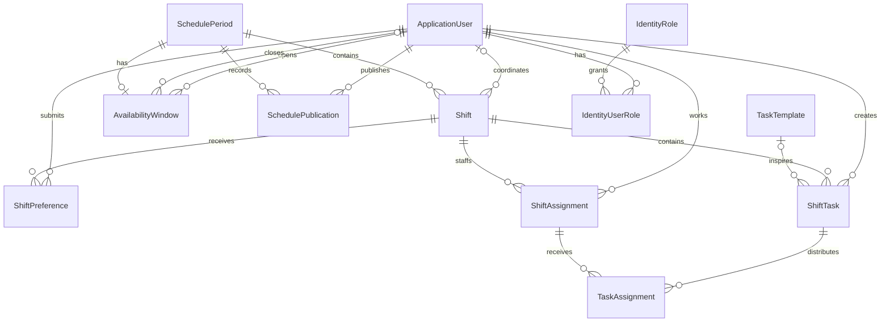

# Database architecture

## Phase 3 extension

[Availability architecture](availability-architecture.md) documents the implemented window,
submission and hard-block rules. AvailabilitySubmission adds durable user/period submission
status, UTC timestamp and version, with unique and RESTRICT constraints. Availability writes
now use month-creation lock → period row lock → whole-employee advisory lock, a safe coarser
alternative to the weekly-key proposal below. PostgreSQL triggers reject new assignment/block
conflicts. Scheduling/publication/task services below remain deferred requirements.

## Phase 4A extension and staffing transition

[Scheduling architecture](scheduling-architecture.md) documents the new ShiftTypeDefinition
configuration and 51-row weekly workspace. Existing Shift/ShiftAssignment data is unchanged.
The old five-staff-per-time-shift proposal below is historical and does not apply to the
new configurable row requirements: each row has an administrator-defined count, including
zero. No scheduler or publication validation is implemented here. Phase 4B must explicitly
associate row definitions with allocations while preserving the existing DAY/NIGHT Shift
anchors for availability and hard blocks and reviewing legacy lead/assignment constraints.

## Scope and storage conventions

One ASP.NET Core host, one EF Core Identity context, PostgreSQL 17 and GUID keys.
Phase 1 introduced no repositories, CQRS, API endpoints, frontend or scheduling algorithms.
Phase 2 adds account APIs and a Hebrew React interface, described in authentication-architecture.md.
Tables and columns use English identifiers. PostgreSQL's UTF-8 database stores Hebrew
names and task content without special per-column encoding. All actual instants are UTC
`DateTime` mapped to `timestamp with time zone`; `ShiftDate` is `date`, a local calendar
value. Npgsql rejects non-UTC DateTime values for timestamptz. The database does not
retain the original time zone. Required text cannot be NULL; names and task titles also
cannot be blank. Descriptions may be empty, but cannot be NULL.

## Entities and relationships

| Entity | Purpose and cardinality |
| --- | --- |
| ApplicationUser | GUID Identity user; first/last name, active flag, creation time. Multiple Identity roles supported through the standard user-role join. |
| SchedulePeriod | Unique calendar year/month, DRAFT or PUBLISHED, creation/update instants. Has many shifts and publications; zero or one availability window. |
| AvailabilityWindow | One per period when present; OPEN/CLOSED with open/close instants and opening/closing users. |
| Shift | Starts on a local ShiftDate, DAY/NIGHT, belongs to one period; optional coordinator; many preferences, staffing assignments and tasks. |
| AvailabilitySubmission | One per user/period; official submission timestamp and monotonically increasing version, including all-Available submissions. |
| ShiftTypeDefinition | 51 persistent ordered board rows with editable name, DAY/NIGHT, staffing, automatic inclusion and version. |
| ShiftPreference | One user/shift preference, BLOCKED or PREFERRED. No row means neutral. |
| ShiftAssignment | One employee per shift, with per-shift lead flag; many task assignments. |
| TaskTemplate | Reusable name/description and active flag; many optional references from shift tasks. |
| ShiftTask | Task in one shift; independent title/description, optional template and required creator. Template edits do not alter historical task content. |
| TaskAssignment | Connects a shift task and staffing assignment, with explicit UTC start/end. Multiple and overlapping tasks are allowed. |
| SchedulePublication | Publisher, timestamp and version per period. Event log only; does not snapshot schedule content. |



Identity roles ADMIN, COORDINATOR and EMPLOYEE have deterministic GUID seeds. Lead is
never an Identity role. Users can have multiple roles; inactive users remain for history.
Public registration, default credentials, plaintext password storage and custom hashing remain absent.
`AddIdentityCore`, GUID role services, EF stores, data protection and default token
providers are configured. Phase 2 adds cookie handlers, authentication/account endpoints and centralized Hebrew errors.
ApplicationUser.MustChangePassword is a non-null boolean added by RequirePasswordChange
(default false for existing records; managed creation/bootstrap explicitly set true).
No existing business tables or historical relationships are changed.

## Database integrity

- Unique year/month, shift date/type, user/shift preference, user/shift staffing assignment,
  period/publication version, and period/window relationship.
- PostgreSQL filtered unique index on ShiftAssignment.ShiftId where IsShiftLead = TRUE:
  drafts may have no lead; two leads can never be stored.
- Month 1–12, year 1–9999, positive publication versions, allowed enum strings,
  end-after-start shift/task intervals, and nonnegative availability-window intervals.
- All relationships use explicit RESTRICT deletion, including Identity joins. Deleting a
  referenced entity fails instead of cascading through historical records. Use inactive
  flags; any future cleanup must deliberately delete dependents in a reviewed transaction.
- Task assignment triggers validate same-shift membership and containment inside shift
  boundaries. They lock parent rows while validating. Parent changes to shift boundaries
  or task/staffing shift IDs are rejected while task assignments exist; remove/recreate
  affected task assignments in a transaction before making such changes.
- FKs are indexed by EF convention. ShiftId in the staffing composite unique index also
  supports fetching all members; the filtered lead index applies only to lead rows.
- PostgreSQL check constraints do not count staffing or infer role membership.

## Time and Hebrew/RTL contract

`ShiftClock.Boundaries` converts each local boundary separately using Asia/Jerusalem:
DAY is 07:00–19:00, NIGHT is 19:00–07:00 next day. A DST night is 11 or 13 elapsed hours,
while retaining these local clock boundaries. Never calculate the end by adding 12 UTC
hours. The fixed boundary hours avoid the ambiguous/nonexistent transition hours.
The starting local date defines the owning month, including the last night of a month.
Future services must use this clock and validate the date against the selected period;
positive duration alone does not enforce those cross-table/calendar rules.

The future frontend must be Hebrew with `lang="he"`, `dir="rtl"`, central translation
resources, he-IL locale, explicit DD/MM/YYYY formatting and 24-hour times. Locale defaults
alone do not guarantee a particular date pattern. Weeks are Sunday–Saturday in Israel
local dates. Define week start as local date minus its DayOfWeek integer, across month
and year boundaries. APIs should return stable English error codes with Hebrew messages
from centralized resources; do not expose raw database/Identity errors to users.

## Deferred service rules and concurrency

Phase 1 has no scheduling/task services. Phase 2 adds transactional account services only.
Future scheduling/task services must validate:

- Employee/coordinator/admin permissions, active users, and coordinator excluded from the
  staffing members; having multiple roles alone must not permit double counting.
- Availability window open status and timestamps, modification permissions and closing
  metadata consistency; maximum three BLOCKED shifts per user per Sunday–Saturday week,
  counting records across all periods; blocked means a hard constraint for every manager.
- Shift membership in its period and canonical local start/end boundaries; employee cannot
  work consecutive shifts, including period boundaries. Preferred is a soft constraint.
- Drafts can be incomplete. Publication validates every expected day/night shift exists,
  staffing according to the Phase 4A row configuration (superseding the original five-person
  proposal) and a deliberately designed lead rule, all hard constraints satisfied,
  and writes status/version/event atomically. Soft preferences never override hard blocks.
- Task creators/editors must be coordinators; employees only view. Task assignments must
  remain inside the corresponding shift and target a current staffing assignment. Database
  triggers provide a final backstop; service errors should explain violations in Hebrew.
- CreatedAt/UpdatedAt/PublishedAt are set by future services from a UTC clock, never client
  input. No automatic audit stamping or optimistic concurrency token is currently added.

Transactions must be explicit and consistent across every mutation path:

1. For blocking limits, take a transaction-scoped PostgreSQL advisory lock keyed by stable
   `(user GUID, Sunday local date)`, then count/update preferences across months. Lock all
   affected old/new weeks in deterministic order. Alternatively use SERIALIZABLE and retry
   SQLSTATE 40001. A count under ordinary READ COMMITTED is insufficient.
2. For staffing changes, lock the period then affected shifts with `SELECT ... FOR UPDATE`
   in GUID order. Revalidate roles, blocks and adjacent shifts under the same transaction.
   Also lock the employee across neighboring periods (stable advisory key), so two requests
   cannot independently assign consecutive shifts. Never use process-local locks.
3. Lead changes lock the shift; clear the old lead before assigning the new lead in the
   same transaction. The filtered index is immediate, so insertion order matters.
4. Every period mutation and publication must lock that period first. Publication then
   locks all shifts deterministically, validates, allocates the next version and persists
   the status/publication event atomically. A publication-only lock is insufficient if
   other writers ignore it. Unique version is a final backstop, not the allocation strategy.
5. Preference/window edits must participate in period locking as well as weekly locking.
   Choose one global lock ordering and apply it to all services, including bulk operations.
   Retry serialization/deadlock failures (40001/40P01) with bounded backoff and idempotency.
   A future API may add PostgreSQL xmin concurrency tokens for stale edit detection; these
   do not replace transaction locks for cross-record constraints.

## PostgreSQL and migrations

See README for Docker Compose setup and secrets supplied through environment variables.
Use a UTF-8 PostgreSQL database and persist tzdata updates on deployment hosts. Production
credentials belong in secret storage; never commit them or log connection strings.

```sh
dotnet tool restore
dotnet ef migrations add DescriptiveName --project src/ShiftManager --output-dir Data/Migrations
dotnet ef database update --project src/ShiftManager
dotnet ef migrations script --idempotent --project src/ShiftManager -o /tmp/shiftmanager.sql
RUN_POSTGRES_TESTS=1 dotnet test
```

The initial migration includes Identity tables, role seeds, business constraints and
PostgreSQL task-integrity functions/triggers. Integration tests apply it using MigrateAsync
against fresh Testcontainers databases. Model tests do not require PostgreSQL and do not
use EF InMemory. PostgreSQL tests are explicitly skipped without RUN_POSTGRES_TESTS=1.

## Limitations and next phase

Publication events are not historical snapshots. No timezone database is bundled; the
host's Asia/Jerusalem rules are authoritative. Scheduling/task mutation paths and transaction
protocols above remain design requirements. There are no scheduler or task APIs yet.
Authentication, Hebrew error resources and account management are implemented in Phase 2; see authentication-architecture.md.
Task parent edits with existing assignments deliberately require explicit reassignment.
Phase 3 now implements transactional availability services; scheduling/publication remain next.
Account writes already use their own PostgreSQL transaction/advisory-lock protocol,
including final-active-administrator protection and immediate session-stamp revocation.

## Automatic scheduling drafts (Phase 4B)

`SchedulingCell` uniquely identifies a definition/date and stores actual UTC endpoints,
required staffing/configuration snapshots, period and latest saved run. `ShiftAssignment`
remains the employee membership table, with nullable cell/run provenance and `IsLocked`.
Legacy memberships have no cell and remain protected. `SchedulingRun` stores approving
administrator, input fingerprint, solver status/proven objectives and shortage totals.
All FKs restrict deletion; canonical Shift/User membership and lead indexes are retained.
Previews live only in a bounded server queue. Explicit draft save is transactional and
uses existing period/employee locks plus account/configuration and cross-process scheduler
locks. The additive migration extends PostgreSQL hard-block triggers to overlapping cell
intervals. See [scheduling architecture](scheduling-architecture.md) for the full model,
locking order, regeneration rules, limitations and manual verification.

## Phase 4C additive schema

`TeamManagement` adds `OrganizationalTeam`, `TeamMembership` and `DelegatedAvailabilityAudit`, four fixed team seed rows, unique membership and composite leadership/membership foreign keys with restricted deletion. Existing availability, Identity and scheduling tables remain authoritative. An audited transaction-local path allows delegated hard blocks against retained draft assignments while preserving hard-block guards on new assignments. See [team architecture](team-management-architecture.md) for constraints, transaction order and migration verification.

## Phase 5 schema

Two additive migrations expand `SchedulePeriod` lifecycle/revision fields and `SchedulePublication` with immutable JSONB snapshots and explicit shortage/report acknowledgments. `ScheduleIssue` preserves version-specific employee reports independently of mutable live assignment rows; `ScheduleEditAudit` records before/after manual operations. PostgreSQL triggers prevent mutation/deletion of publication and edit-audit history. Existing PUBLISHED records retain LEGACY/null snapshot semantics. See [migration/rollback policy](publication-architecture.md).
