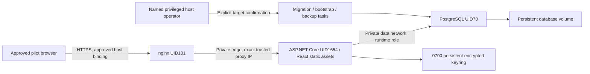

# Phase 7E — Pilot readiness and deployment preparation

## Executive summary

**Recommendation: NOT READY for live employee use.** A provider-neutral Production package and synthetic local validation are prepared for review. The remaining PostgreSQL Critical/High findings have not been accepted, hosting/domain/budget are undecided, and encrypted off-host/key-bundle recovery plus an operational owner are still deployment gates. No risk is accepted on the developer's behalf. Pilot readiness would not imply unrestricted production readiness.

Work is isolated on `feature/phase-7e-pilot-readiness`, based on verified Phase 7D merge `4919a17e9d791b55aef94806ad557760d7246009`. Local main and origin/main already matched the read-only remote verification; no synchronization mutation was needed. Phase 4C and subsequent scheduling/security/performance work are present. Main, remote refs, branch protection and existing development/demo databases were not modified. No branch was pushed, PR opened or external deployment performed.

Machine-readable evidence is in [phase-7e-pilot-readiness-results.json](phase-7e-pilot-readiness-results.json). This report distinguishes a local PASS from hosting decisions and live-use approval. GitHub Actions execution for this branch remains **PENDING**.

## Proposed architecture and trust boundaries



One Linux host with Docker Compose is the simplest proposed small-pilot topology. No Kubernetes, microservices, new business rules or UI redesign are introduced. The real Production image serves the compiled Vite assets and runs the native OR-Tools solver. PostgreSQL is private and unexposed; the app is unexposed. Only proxy TLS is published, loopback by default. The proxy has a separate ingress bridge; edge/data networks are internal. Docker/host administrators remain trusted and privileged.

The reverse proxy replaces `X-Forwarded-For`/`Proto`, strips alternate forwarded host headers, rejects unknown hosts and blocks public health paths. ASP.NET trusts one explicitly configured static proxy IP and one hop. No arbitrary forwarded-header trust is enabled. Same-host private PostgreSQL traffic currently uses SCRAM authentication without database TLS; the host/network trust boundary requires approval. A remote managed database requires verified TLS and a separately validated topology.

All services run non-root with read-only root filesystems, dropped capabilities, no-new-privileges, bounded temporary storage/CPU/memory/PIDs, and named state volumes. The .NET runtime is chiseled; it has no shell/package manager. PostgreSQL runs directly as UID70, so its root-to-user `gosu` path is skipped. This reduces startup exposure but does not erase image findings.

## Environment and reproducibility

- [Dockerfile](../deploy/pilot/Dockerfile): digest-pinned Node build, .NET SDK build and .NET 10.0.14 chiseled runtime; locked npm dependencies, production publish with warnings as errors and native solver runtime.
- [Proxy Dockerfile](../deploy/pilot/Dockerfile.proxy): digest-pinned maintained nginx base and exact available security package upgrades. Initial proxy candidates with High/Critical findings were rejected; the final built proxy scan has zero High/Critical findings.
- [Compose](../deploy/pilot/compose.yaml): Production/PILOT_MODE separation, private file secrets, operation-only profiles, persisted database/keys, health checks and graceful shutdown. It never loads the developer's `.env`.
- [Configuration template](../deploy/pilot/configuration.example.json): non-secret identities, paths, origin, static private addresses and immutable image references; intentionally requires operator replacement.
- [Operations CLI](../scripts/pilot.py): exact `deployment-id/database` confirmation, container/project/image/marker checks, safe new-database provisioning, explicit migration/bootstrap, encrypted live backup requirement and refusal to overwrite restore targets.
- [Production drill](../scripts/test-pilot-deployment.py): fresh synthetic identities/secrets/resources, loopback TLS, owned cleanup and status-only evidence. It never points at a persistent dev/demo database.

Required settings include Production + PILOT_MODE, stable deployment ID, namespaced database, expected runtime/migrator role, origin, exact proxy address, secret-file paths, 0700 key directory and valid private protection certificate. Missing/invalid configuration fails startup safely without echoing a secret. App startup never auto-migrates a database; migrations run as a separate operation. Bootstrap is idempotent and forces an initial password change.

The tested local environment is macOS ARM64 with Docker Desktop, .NET SDK 10.0.403/runtime 10.0.14, one Chromium worker and bounded two-CPU solver configuration. Native Linux ARM64 Production containers are exercised locally; Linux AMD64 execution is added to CI but has not been observed remotely. Base-image digests fix inputs, but availability of apt/apk/NuGet/npm registries remains a build dependency; proxy package pins fail closed if withdrawn. Preserve/review built immutable image digests rather than relying on a mutable tag.

## Security and session controls

Production retains `__Host-` authentication/CSRF cookies, Secure, HttpOnly, SameSite Strict, host-only scope and `/` path. The browser auth cookie is a session cookie; the protected server ticket expires after a fixed eight hours without sliding extension. Missing CSRF is rejected, arbitrary-origin CORS is not enabled, logout invalidates a copied cookie, and trusted HTTPS is required. The local drill uses strict certificate verification in Python; Chromium trusts only the generated leaf's SPKI. It does not disable verification globally.

Team Lead, Deputy, Worker and Coordinator administrator-only access is denied in the Production simulation. Independent absence approval, protected schedule notes, stale-token/concurrency controls and immutable publication history remain intact. No self-registration or role escalation feature is added. Existing security regressions also run in the full backend/browser suites.

Runtime, migrator, backup and instance owner are separate. Runtime can perform application DML, not schema DDL or migration-history DML. Backup can SELECT application tables/sequences, not create schema; migrator owns schema objects. PUBLIC database/schema privileges are revoked. The marker schema is owner-controlled and read-only to these three roles. Role/database creation refuses pre-existing objects instead of adopting them. Instance-owner credentials are never mounted into the app.

## PostgreSQL vulnerability reassessment

The exact pin remains:

```text
postgres:17.11-alpine3.24@sha256:3540c0362c809df084ffac0ae69fe794515f9de92692f02178bcdce0ef0302ac
```

Trivy 0.76.2 rescanned both Linux ARM64 and AMD64 on 2026-11-08 using the available vulnerability database (updated 2026-11-07 18:32 UTC). Both report **25 High + 1 Critical**, all Go `stdlib v1.24.6` metadata in `/usr/local/bin/gosu`. No High/Critical Alpine package findings remain in that preserved image. The exact IDs/severities/fixed Go versions are retained in the evidence JSON; the [Phase 7C.1 advisory table and source review](phase-7c-security-validation.md#phase-7c1--postgresql-container-security-remediation) provide the individual primary Go advisory links. Do not interpret this count as all-severity scanning or proof of exploitability/non-exploitability.

Critical **CVE-2025-68121 / GO-2026-4337** concerns Go TLS session resumption; fixed Go releases include 1.24.13/1.25.7. Other findings cover TLS/X.509, HTTP, URL, mail, MIME, ASN.1, XML, `os.Root` and related standard-library APIs. Upstream Go fixes exist, but upgrading Alpine packages does **not** rebuild the embedded Go runtime in gosu. A newer helper/image is not an approved drop-in replacement without verified provenance, architecture support, current scans and regression validation. No PostgreSQL pin change is made in this phase.

Repository source/advisory evidence shows gosu is a UID/GID/group switch plus `exec` startup helper, not an HTTP/TLS service. Its inspected application path does not demonstrate calls into these vulnerable network/parsing APIs. CVE-2026-39836 is Windows-only in the recorded Go advisory, so that specific affected-platform condition does not apply to the Linux image. This is reachability reasoning, **not** a blanket false-positive dismissal or binary proof. The exact retained binary was not newly proved unreachable with whole-program analysis in this phase. A user-controlled environment, future helper behavior or another reachable library path can change exposure.

Mitigations are UID70 execution (skips gosu user switching), private database networking, no host port, no new privileges/capabilities, immutable image pin and restricted Docker/host access. A compromised host/privileged operator remains outside those controls. **Residual risk remains open and live use is BLOCKED until an authorized owner either approves a verified remediation or explicitly accepts the documented risk with scope, mitigations, expiry and review date.** No acceptance has been received. The final app and patched proxy each scan with zero High/Critical findings on the locally built ARM64 images; that does not offset the PostgreSQL finding or validate the final host.

## Secrets and Data Protection

Secrets are file-mounted per consumer, never committed, supplied as process password arguments or emitted into status artifacts. No real credentials are created. The local harness's random credentials/certificates are synthetic, private and disposable. Compose file secrets are bind mounts; encrypted host storage and per-service Linux ACL/ownership are still needed. The different Docker Desktop test UIDs use read-only secret files under a host-private parent; final-host permission validation remains pending.

Data Protection uses a stable deployment discriminator, persisted UID1654 0700 volume and certificate-wrapped XML key material. The real drill checks encrypted XML and same-cookie continuity across app restart/replacement, and verifies persisted DB contents across DB restart. The certificate/PFX password must be backed up separately with the full ring and stable config; SQL dump alone is insufficient. Retaining all secrets on one compromised host is not protection against that host's administrator. Certificate rotation is a planned maintenance concern: this package loads one protection certificate; do not replace it and assume old keys decrypt. The runbook documents retention and session-invalidating recovery choices.

## Backup, recovery and migrations

Backups use PostgreSQL custom-format consistent logical snapshots through the read-only backup role, with no ownership/ACL restoration or ownership-marker schema. Live backup requires a valid approved age recipient and installed tool, and streams directly into encryption. Destination reuse, wrong deployment/checksum, restoration over primary/nonempty targets and unencrypted live restore are refused. Failed operations never publish success; partial files require diagnosis.

The local synthetic drill restores into a separately provisioned, marked `_restore_<suffix>` database, verifies **every public table** by count/canonical-row fingerprint, then switches only the owned app's private connection files. All restored sessions are invalidated before exposure so an old snapshot cannot resurrect a logged-out cookie. Other data must remain identical after invalidation. The source database is retained until harness cleanup of its own new volume. Actual timings/table counts are recorded in the evidence JSON.

The drill uses a private unencrypted synthetic archive only. It does not prove age encryption/decryption, off-host retention, a lost-host key-bundle recovery or final-host RPO/RTO. Those require an owner-approved host rehearsal. Proposed targets are **24-hour RPO / four-hour RTO**, not guarantees; proposed retention is seven daily/four weekly/three monthly copies with an encrypted off-host copy and no automated deletion in this phase.

Final local results: **15/15 Production checks PASS**, including all **34 public tables** matching before session invalidation. Backup took **0.40 seconds**, SQL restoration **0.40 seconds**, and the measured separate-database recovery sequence reached ready service in **10.84 seconds**. These are small synthetic same-host measurements, not a host-loss RTO. Resource cleanup passed with no pilot containers/networks/volumes left; both original development/demo container IDs, November 5 start times and zero restart counts remained unchanged.

Migration rehearsals cover clean install plus repeated no-op migration/bootstrap. Future migrations require backup, clone rehearsal, SQL/compatibility/locking review and restricted access. No automatic EF rollback is promised: roll-forward or separate-database restoration is a reviewed decision, especially if data is transformed/deleted.

## Health, observability and reliability

`/health/live` checks only the running process; `/health/ready` verifies a bounded PostgreSQL connection and, in pilot mode, exact database/session role/ownership marker/application schema. Responses contain only status. Health bypasses HTTPS redirection for the internal localhost container probe; the TLS proxy blocks `/health/` publicly. Every pilot API request also verifies database readiness/identity and returns generic Hebrew 503 when unavailable, instead of accepting writes against an unverified target.

JSON request logs contain method/status/duration/server-generated request ID, without added URL, body, identity, cookie or connection details. EF SQL/diagnostic exception payload logging is suppressed. Logs are bounded at three 10 MiB files/service. The incident runbook distinguishes app failure, dependency outage, auth/CSRF rejection, solver failure and invalid configuration. Monitoring ownership, backup freshness alerts, disk/certificate monitoring and external incident routing are still required decisions; no outbound monitoring stack is introduced.

## Onboarding and complete pilot simulation

[Account/support runbook](operations/pilot-accounts-and-support.md) covers initial/second administrator, existing four team slots, membership/Lead/Deputy assignment, employee roles and qualifications, shift/staffing review, availability windows, private initial credentials, forced change, forgotten-password handling, account disable and emergency admin recovery. No real identities are used in fixtures. A real operator onboarding rehearsal remains pending.

The Production simulation provisions admin and employee roles, opens/submits/delegates/closes availability, generates a real monthly schedule, previews shortages, saves/reviews/publishes a preliminary version, allows employee viewing/issue reporting, applies a protected-note correction, resolves the issue and publishes final. It exercises exchange consent/admin approval/republication, rejects absence self-approval, accepts independent Deputy approval and performs explicit replacement/republication. It verifies no hard conflicts and unchanged original publication snapshot. Expected staffing shortage is explicitly acknowledged; no claim of complete staffing is made.

Operational checks cover repeated migration/bootstrap, secure cookies/CSRF/CORS, trusted proxy overwrite and direct untrusted forwarded-header rejection, internal-only health, no E2E routes, non-root/read-only/capability/port posture, role permission denials, encrypted keys, app restart/replacement, graceful exit, DB restart, owned DB outage, invalid runtime credentials, missing config, browser RTL/secure context, logout replay denial and separate-database recovery. Exact observed PASS checks are in the evidence; a missing check is not presumed passed.

## Tests and CI

The existing Phase 7D split stays intact: correctness excludes long solver benchmarks; the budget matrix runs exactly two scenarios at each of 30/60/120 seconds, max parallel two; required `Backend` aggregate fails closed. The new `Production pilot package` job builds real images, runs offline operation guards and a single small synthetic Production workflow/recovery drill, then uploads only status evidence. This is distinct from the six benchmark experiments; it does not rerun them. `Backend` now also requires the pilot job, without changing branch protection or required check names.

Local validation: the final 436 backend correctness/security tests pass (226.65 seconds); 128 frontend tests pass; 31 browser workflow and two bounded performance/recovery tests pass with no skips/flaky outcomes; 12 operation-guard tests, four browser artifact-safety tests, two timing-parser tests and nine scanner-installer tests pass. Release build with warnings as errors, production Vite/TypeScript build, E2E type checks and the pinned PostgreSQL image health/durability test pass. NuGet/npm report zero advisories; redacted source/history secret scans report zero findings. The full backend suite was rerun after the final recovery-identifier fix. Results are recorded in evidence.

All **six required benchmark experiments** ran once locally. Normal at 30/60/120 seconds reached OPTIMAL with all six objective stages proved and fairness target met (cohort spread one). Severe-shortage at all three budgets returned FEASIBLE with zero objective stages proved and fairness not reached. Passing the benchmark test asserts hard correctness and report validity, **not** proof of optimization quality or fairness acceptance. Severe-shortage quality remains an explicit pilot review item; budgets/objective priorities/constraints were not changed to force acceptance. No repeated expensive benchmark runs were added after documentation/key-inspection-only changes.

Remote Actions results for this unpushed branch are PENDING. The final Linux host, TLS chain, ACLs, recovery tools and AMD64 execution must be verified before deployment. No local result substitutes for those checks.

## Required external decisions and blockers

The developer answered **“Undecided — document options and required decisions”** for hosting/domain/budget. Options:

| Option | Fit / tradeoff | Decision required |
| --- | --- | --- |
| Existing controlled Linux host + VPN | Smallest cost/operational footprint; owner handles disk, patching, backups and access | Approved host capacity, operator, storage and private access |
| Small dedicated VM + restricted ingress | Closest match to this Compose package; provider/region/cost and firewall ownership required | Provider, region, budget, domain/TLS, VPN/allowlist, encrypted disks/off-host backups |
| Managed app/database hosting | Can reduce host duties; changes networking/TLS/key persistence/roles and needs another rehearsal | Provider/budget plus a separately validated adapted topology |

No provider, paid plan, region, domain or public exposure is selected. Obtain explicit real-deployment/data authorization after reviewing this package. Also approve PostgreSQL remediation/risk disposition, representative severe-shortage scheduling quality, security owner, backup/recovery owners, age recipient/private identity custody, RPO/RTO/retention, privacy/log policies, TLS and protection-certificate renewal, host key-bundle backup method, onboarding/support and incident contact. No risk acceptance is inferred from choosing a host.

## Pilot readiness checklist

PASS means observed locally at the scope stated. PENDING means a decision/environment check remains. BLOCKED means live use cannot proceed safely. No item currently qualifies as ACCEPTED RISK.

| Item | Status | Evidence / unresolved boundary |
| --- | --- | --- |
| Reproducible Production configuration | PASS | Actual local image build/Compose clean installation |
| HTTPS/proxy/cookies/CSRF/CORS | PASS | Local trusted TLS and negative checks; public domain chain PENDING |
| Encrypted persisted Data Protection keys | PASS | XML inspection and restart/replacement cookie continuity |
| Live host storage/secret ACLs/key-bundle recovery | PENDING | Host undecided; Desktop file-secret permissions are not a live policy |
| Secret hygiene/startup validation | PASS | Synthetic-only provisioning, fail-closed config, redacted audits |
| PostgreSQL private networking/role separation | PASS | No host DB port, marked target, DDL/history denials |
| PostgreSQL vulnerability disposition | BLOCKED | 25 High + 1 Critical, no authorized acceptance/remediation |
| App/proxy image High/Critical review | PASS | Current local ARM64 scans zero H/C |
| SQL backup/separate restore/data integrity | PASS | Synthetic complete-table drill; details in evidence |
| Encrypted off-host + key-bundle/host-loss drill | BLOCKED | Not exercised; tools/custody/storage/owner undecided |
| RPO/RTO/retention approval | PENDING | Proposed targets only, not production guarantees |
| Health/outage/invalid-credential recovery | PASS | Liveness/readiness split and safe API 503/recovery |
| Safe structured logs/correlation/bounds | PASS | Production configuration and response ID checks |
| Monitoring/incident operational ownership | PENDING | No owner/contact/alert routing chosen |
| Initial admin/forced password/role restrictions | PASS | Synthetic Production simulation |
| Real administrator/employee onboarding rehearsal | PENDING | Runbook prepared; owner/user invitations not authorized |
| End-to-end scheduling/approval/publication | PASS | Complete synthetic workflow; no hard conflicts |
| Severe-shortage optimization quality acceptance | PENDING | FEASIBLE/unproven at all budgets; no fairness proof |
| Automated local regressions/required experiments | PASS | Counts/results in evidence |
| New remote CI / final architecture execution | PENDING | Branch unpushed; Actions not observed |
| Existing persistent data isolation | PASS | Existing demo/dev containers untouched; owned test cleanup verified |
| Hosting/domain/budget/TLS/public exposure | PENDING | Developer undecided; explicit approval still required |

## Final recommendation and runbooks

**NOT READY** for live employee use until the BLOCKED items close and applicable PENDING items receive a verified decision. The local package can be reviewed and, when the developer chooses, pushed for CI review; this phase performs neither action remotely. Choose the host/access model, decide the PostgreSQL findings and shortage quality, assign owners, prove encrypted off-host/key recovery, run remote CI, then request explicit controlled-pilot deployment approval. Keep the initial user cohort small and reassess capacity/quality/recovery using approved representative data.

- [Deployment/startup/shutdown/safe updates/migrations](operations/pilot-deployment.md)
- [Secrets, key protection and rotation](operations/pilot-secrets-and-keys.md)
- [Backup, separate restore and rollback/roll-forward](operations/pilot-backup-recovery.md)
- [Onboarding, accounts and administrator recovery](operations/pilot-accounts-and-support.md)
- [Troubleshooting, incidents and emergency restriction](operations/pilot-incidents.md)

Primary references used alongside repository evidence: [ASP.NET forwarded headers](https://learn.microsoft.com/en-us/aspnet/core/host-and-deploy/proxy-load-balancer?view=aspnetcore-10.0), [Data Protection key storage/encryption](https://learn.microsoft.com/en-us/aspnet/core/security/data-protection/implementation/key-encryption-at-rest?view=aspnetcore-10.0), [Docker Compose file secrets](https://docs.docker.com/compose/how-tos/use-secrets/), [PostgreSQL 17 pg_dump](https://www.postgresql.org/docs/17/app-pgdump.html), [PostgreSQL 17 pg_restore](https://www.postgresql.org/docs/17/app-pgrestore.html), [gosu 1.19 security policy](https://github.com/tianon/gosu/blob/1.19/SECURITY.md) and individual Go advisories linked from the earlier security assessment.
